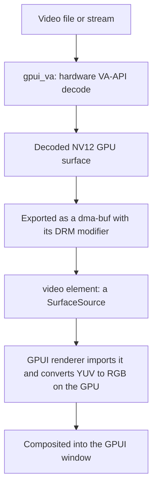

# gpui_video

Play hardware-decoded video directly inside a [GPUI](https://github.com/zed-industries/zed) window —
on the GPU, with no CPU copy in the steady state.

A hardware decoder renders frames into GPU surfaces, exports them as OS handles (`dma-buf` on Linux),
and GPUI's renderer samples them in place. A video in a view is one element, with HTML5-shaped
controls:

```rust
use gpui_video::video;

let picture = video()
    .source("movie.mp4")
    .controls(true);
```

## Status

- **Linux / VA-API** is the implemented backend (`gpui_va`). macOS (VideoToolbox / CoreVideo) and
  Windows (Media Foundation) are designed to drop in behind the same API; neither is built.
- The crates are **pre-release (`0.1.0`) and are not published under these names.** The `gpui-video`
  name on crates.io is an unrelated project — do not depend on it. The published names are not
  decided in this repository.
- **The decoder must share the renderer's GPU.** A `dma-buf` is importable only on the GPU that
  exported it, so the VA-API device and the `gpui_wgpu` renderer must be the same physical card.

## Crates

| crate | what it is |
| --- | --- |
| `gpui_video` | The library an application uses: the `video()` element, `Source`, `Player`, frame pacing and the default control bar. |
| `gpui_va` | The Linux decoder: VA-API into driver-tiled NV12 GPU surfaces, exported as `dma-buf`s. It loads `libva`, `libavcodec`, `libavutil`, `libavformat` and `libswscale` at runtime. |
| `gpui_video_platform` | `SurfaceProducer`, the one-method seam a decoder, a capture pipeline or a 3D renderer implements to feed the element. |

The surface transport underneath is [`gpui_interop`](https://github.com/bite-gpui/gpui_interop).

## The element

```rust
use gpui_video::{Player, Source, video, video_controls};
```

`video()` returns an ordinary element — `Styled`, `IntoElement`, composited like any other child.
The builder:

- **`.source(impl Into<Source>)`** — the no-entity shape. The element opens the decoder on a
  background thread, paces playback to the stream's timestamps, and keeps the player in an entity it
  creates, so the default controls have something to read and drive. `Source` accepts a path
  (`&str`, `String`) or an in-memory elementary stream (`&[u8]`, `Vec<u8>`).
- **`.player(Entity<P>)`** where `P: Player` — the view is a face on an entity you own.
  `cx.notify()` on the player repaints the view, and the default controls read that same entity.
  `Player` is surface plus an **optional** transport (`play`, `pause`, `toggle`, `position`,
  `duration`, `seek`, scrub); a player with no transport is simply always playing.
- **`.producer(impl FnOnce() -> Box<dyn SurfaceProducer>)`** — own the producer directly, when there
  is no entity. The factory is called every frame but used once, so the decoder survives across
  frames. This shape has no transport, so it draws no default controls.
- **`.controls(impl Into<Controls>)`** — `true` draws the default bar, `false` draws nothing, and an
  element (for example `video_controls(player)`, or your own) is drawn in its place.
- **`.overlay(impl IntoElement)`** — anything that is not a bottom bar, filling the picture's bounds.
  It takes precedence over `controls` and is hit-tested first.
- **`.object_fit(ObjectFit)`** — `Contain` (the default) letterboxes; `Fill` stretches.

```rust
// No player to manage.
video().source("movie.mp4").controls(true)

// An entity owns the player; the view is a face on it.
video().player(player).controls(true)

// Your own controls, or none.
video().source(path).controls(video_controls(player))
video().source(path).controls(false)
```

## Quick start

From a checkout of this repository (see [Building from source](#building-from-source)):

```sh
cargo run -p gpui_video --example player            # the bundled clip
cargo run -p gpui_video --example player -- movie.mp4
```

To put it in your own view, `video()` is an element, so it goes where any other child does:

```rust
use gpui_video::{Source, video};

div()
    .size_full()
    .child(
        video()
            .source(Source::from("movie.mp4"))
            .controls(true)
            .flex_1()
            .w_full(),
    )
```

## Requirements

- **Linux**, with a VA-API driver that actually decodes and a Vulkan driver for `gpui_wgpu`.
  `vainfo` lists the profiles a device offers. A device can expose VA-API and still have no decoder
  — an entry-level Optimus `GM108` (GeForce 930M, 940M) has no NVDEC engines, so
  `nvidia-vaapi-driver` initialises but reports zero profiles, FFmpeg falls back to software, and
  `gpui_va` refuses the frame.
- **The decoder and the renderer on the same GPU.** On a hybrid laptop that is the integrated GPU;
  pinning the renderer to a decoder-less discrete GPU leaves no hardware path at all.
- **System libraries.** On Debian or Ubuntu:

  ```sh
  sudo apt-get install -y --no-install-recommends \
    build-essential cmake clang lld llvm pkg-config \
    libasound2-dev libfontconfig-dev libgit2-dev libglib2.0-dev libsqlite3-dev \
    libssl-dev libva-dev libvulkan1 libwayland-dev libx11-xcb-dev libxkbcommon-x11-dev libzstd-dev
  ```

  `libva`, `libavcodec`, `libavutil`, `libavformat` and `libswscale` are loaded at runtime, so the
  workspace compiles without them and hardware-dependent tests skip; they are required to play.
- **Rust:** a toolchain supporting the 2024 edition.

## Examples

| example | crate | what it shows |
| --- | --- | --- |
| `player` | `gpui_video` | The full player: hardware decoding off the UI thread, timestamp-paced frames, the HTML5-style control bar, and the video's native colour space preserved. |
| `grid` | `gpui_video` | A multi-stream stress test: a grid of independent decoders with live FPS and CPU/GPU metrics, toggling between zero-copy `dma-buf` and CPU read-back. |
| `surface` | `gpui_va` | Every way to composite pixels GPUI did not draw, through both `surface()` and `gpu_canvas`, across the formats the renderer supports. |
| `readback_bench` | `gpui_va` | Zero-copy `dma-buf` versus CPU read-back, breaking down the GPU-to-CPU transfer and the software conversion. |

```sh
cargo run -p gpui_video --example player
cargo run -p gpui_video --example grid                          # zero-copy dma-buf grid
cargo run -p gpui_video --example grid -- --readback            # start in CPU read-back mode
cargo run -p gpui_video --example grid -- --cols 4 --rows 4     # a 4x4 wall
cargo run -p gpui_va    --example surface
cargo run -p gpui_va    --example surface -- --tab 2            # open on a given format tab
cargo run --release -p gpui_va --example readback_bench -- movie.mp4 300
```

## How it works



### Zero-copy, in constant memory

For each frame, `gpui_va` exports the VA-API surface as a `dma-buf`, preserving the driver's native
tiling modifier; GPUI's renderer imports it and does the YUV-to-RGB conversion during compositing.

To keep the decoder from overwriting a surface GPUI is still drawing, each exported handle carries a
**release descriptor**: the renderer signals it from its submission-completion callback, and the
decoder waits for that signal before returning the surface to its pool. A small fixed pool,
synchronised with the renderer, is why an arbitrarily long stream plays in **constant GPU memory**
without tearing or buffering the file.

### Colour

`gpui_va` reads the stream's colour matrix and range and attaches them to each handle; the shader
uses them for the YUV-to-RGB conversion. When a file omits the metadata it falls back to broadcast
convention: limited range, BT.601 at 576 lines and below, BT.709 above.

## Limitations

- **No transfer function yet.** The colour pipeline models a matrix and a range but not the transfer
  function, so an sRGB-encoded producer's bytes are sampled as linear. Tracked as
  [issue 0013](https://github.com/bite-gpui/bite-gpui-project/blob/main/issues/0013-transfer-function-and-srgb-sampling.md).
- **Same GPU only.** On a measured Intel + NVIDIA pair a `dma-buf` exported on one device is refused
  on the other on every memory type; the portable modifier is linear, and a tiled buffer does not
  cross vendors.
- **Linux only.** The macOS and Windows backends are designed but not built.
- **Software decoding is refused, not silently used.** A frame FFmpeg fell back to software for is
  rejected, so a machine with no decoder shows nothing rather than a slow path.

## Building from source

The crates are not published, and the workspace develops against its siblings rather than crates.io.
Check out `bite-gpui`, `gpui_interop` and `gpui_video` side by side; the workspace's path
dependencies resolve from there:

```toml
gpui           = { path = "../bite-gpui/crates/gpui", default-features = false }
gpui_authoring = { path = "../bite-gpui/crates/gpui_authoring" }
gpui_engine    = { path = "../bite-gpui/crates/gpui_engine" }
gpui_wgpu      = { path = "../bite-gpui/crates/gpui_wgpu" }
gpui_interop   = { version = "0.1.0", path = "../gpui_interop/crates/gpui_interop" }
```

Each path becomes the published package at release; `Cargo.toml` carries the exact substitution.

## Tests

```sh
# Build the workspace and run the hardware-independent tests (what CI runs):
cargo check --workspace --all-targets
cargo test  --workspace --lib

# Opt-in: decode a frame on a real Vulkan/VA-API device, export a dma-buf, verify the pixels.
# Skips automatically when no suitable GPU is present.
cargo test -p gpui_va --features test-support
```

## Repository structure

```
Cargo.toml                    Workspace and the sibling-checkout dependencies
crates/gpui_video/            The video() element, Player, pacing and the control bar
crates/gpui_va/               The Linux VA-API decoder, fixtures and benchmarks
crates/gpui_video_platform/   SurfaceProducer — the seam a producer implements
```

## License

Apache-2.0. See the crate manifests.
