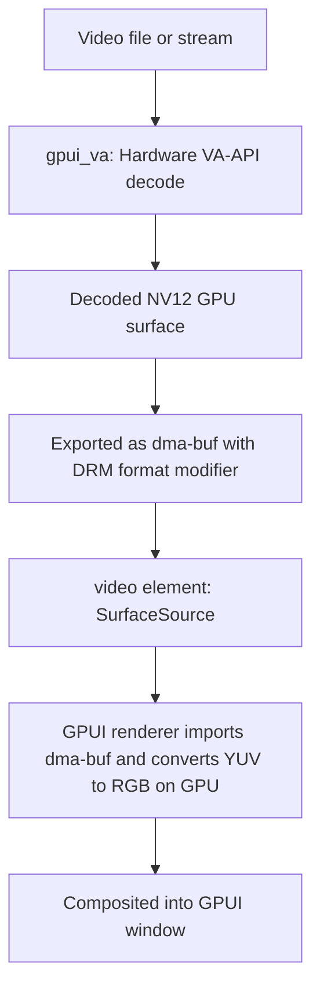

# gpui_video

Play hardware-decoded video directly inside a GPUI window without copying pixels through the CPU.

`gpui_video` provides a high-level video player element backed by a zero-copy GPU pipeline. A platform
hardware decoder renders frames into GPU surfaces, exports them as OS handles (`dma-buf` on Linux), and
passes them straight to GPUI's window renderer to sample on the GPU. Using it in a view takes a single
line of code, complete with built-in playback controls:

```rust
use gpui_video::video;

// Opens the hardware decoder, paces playback to the stream's timestamps, and renders playback controls.
let picture = video().source("movie.mp4").controls(true);
```

## Crates

| Crate | Description |
| --- | --- |
| `gpui_video` | The main library for applications: provides the `video()` element, `Source`, `Player`, frame pacing, and the default playback control bar. |
| `gpui_va` | The Linux hardware decoder backend: decodes video via VA-API into driver-tiled NV12 GPU surfaces and exports each frame as a `dma-buf`. Dynamically loads `libva`, `libavcodec`, `libavutil`, `libavformat`, and `libswscale` at runtime. |
| `gpui_video_platform` | Shared trait definitions (`SurfaceProducer`) that connect video decoders, capture pipelines, and external 3D renderers to the `video()` element. |

Under the hood, this stack relies on [`gpui_interop`](https://github.com/bite-gpui/gpui_interop) to share
textures and synchronization primitives with GPUI's window renderer.

## Requirements

* **Linux:** Currently the only implemented platform backend. Support for macOS (`gpui_cv` via
  VideoToolbox/CoreVideo) and Windows (`gpui_mf` via Media Foundation) is planned and designed to drop
  into the existing `gpui_video` API without requiring application changes.
* **Rust:** A recent toolchain supporting the 2024 edition.
* **Hardware & Drivers:** A GPU with a **VA-API driver** for hardware decoding and a **Vulkan driver**
  compatible with GPUI's `gpui_wgpu` renderer. Because decoded frames are shared as `dma-buf` handles,
  the decoder and window renderer must run on the same physical GPU.
* **A GPU that actually decodes:** a VA-API driver is necessary but not sufficient — a device can
  expose one and still offer no decoding. An entry-level Optimus GPU such as an NVIDIA `GM108`
  (GeForce 930M, 940M) has **no NVDEC engines** at all, so `nvidia-vaapi-driver` initialises but
  reports zero supported profiles, FFmpeg falls back to software, and `gpui_va` refuses the frame.
  Because a `dma-buf` is importable only on the GPU it was exported from, decoding has to run on the
  **renderer's own GPU** — on a hybrid laptop that is the integrated one, and pinning the renderer to
  a decoder-less discrete GPU leaves no hardware path at all. `vainfo`, or the driver's own profile
  list, says which profiles a device offers.
* **System dependencies:** Standard build tools, GUI libraries for GPUI, and `libva` / FFmpeg libraries
  at runtime. On Debian or Ubuntu:

  ```sh
  sudo apt-get install -y --no-install-recommends \
    build-essential cmake clang lld llvm pkg-config \
    libasound2-dev libfontconfig-dev libgit2-dev libglib2.0-dev libsqlite3-dev \
    libssl-dev libva-dev libvulkan1 libwayland-dev libx11-xcb-dev libxkbcommon-x11-dev libzstd-dev
  ```

  Because `gpui_va` loads `libva`, `libavcodec`, `libavutil`, `libavformat`, and `libswscale`
  dynamically at runtime, the project will still compile and skip hardware-dependent tests on machines
  without those libraries installed — though they are required to actually play video.

## Quick start

You can run the standalone player example right from the repository. With no arguments, it plays a
bundled test clip; you can also pass a path to any media file supported by FFmpeg (`libavformat`):

```sh
cargo run -p gpui_video --example player
cargo run -p gpui_video --example player -- path/to/movie.mp4
```

To embed a video player inside your own GPUI view:

```rust
use gpui_video::{Source, video};

video()
    .source(Source::from("movie.mp4"))
    .controls(true)      // shows the default control bar; pass `false` to hide, or pass a custom element
    .flex_1()
    .w_full()
```

If you need programmatic control over playback, you can manage your own player entity and pass it to the
element via `video().player(entity)`. The default control bar automatically binds to that entity, or you
can build custom UI controls against the `Player` trait and headless `Transport` state (see the crate
documentation for details).

## Examples

| Example | Crate | Description |
| --- | --- | --- |
| `player` | `gpui_video` | Full media player demo: runs hardware decoding off the main UI thread, paces frames to stream timestamps, displays an HTML5-style control bar, and preserves the video's native color space so color-graded footage renders accurately. |
| `grid` | `gpui_video` | Multi-stream stress test: renders a grid of independent video decoders (playing staggered loops of the bundled clip by default) with live FPS and CPU/GPU metrics. Lets you toggle between zero-copy `dma-buf` rendering and CPU read-back on the fly to compare performance. |
| `surface` | `gpui_va` | Low-level compositing demo: shows how to display external GPU buffers using both the `surface()` element and the `gpu_canvas` callback across every pixel format supported by the renderer. |
| `readback_bench` | `gpui_va` | Head-to-head benchmark: decodes a video file using both the zero-copy `dma-buf` path and the traditional CPU read-back path, breaking down the time spent in GPU-to-CPU memory transfers versus software format conversion. |

```sh
cargo run -p gpui_video --example player
cargo run -p gpui_video --example grid                         # 16x16 grid using zero-copy dma-buf
cargo run -p gpui_video --example grid -- --readback           # start in CPU read-back mode for comparison
cargo run -p gpui_video --example grid -- --cols 4 --rows 4    # run a 4x4 video wall
cargo run -p gpui_va    --example surface
cargo run --release -p gpui_va --example readback_bench -- movie.mp4 300
```

## How it works under the hood



### Zero-copy frame lifecycle and constant memory

For each decoded frame, `gpui_va` exports the underlying VA-API surface as a `dma-buf` handle
(preserving the GPU driver's native tiling modifier). GPUI's renderer imports that `dma-buf` directly
and performs YUV-to-RGB color conversion on the GPU during compositing.

To prevent the decoder from overwriting a surface while GPUI is still drawing it, every exported frame
handle includes a **release descriptor**:

1. When GPUI's renderer finishes sampling the frame on the GPU, its submission completion callback
   signals the release descriptor.
2. The decoder waits for that signal before returning the VA-API surface back to its internal decode
   pool.

Because the decoder recycles a small, fixed pool of hardware surfaces synchronized with the renderer,
`gpui_video` can play arbitrarily long streams in **constant GPU memory** without tearing or buffering
the entire file.

### Accurate color spaces

`gpui_va` inspects the video stream's color matrix and range metadata and attaches them to each frame's
handle. GPUI's shader uses that metadata during YUV-to-RGB conversion so color-graded footage looks
exactly as intended. If a video file omits color metadata, `gpui_va` falls back to standard broadcast
conventions: limited color range, using **BT.601** for standard definition (576 lines and below) and
**BT.709** above that.

## Using with `bite-gpui` 1.23.301

This workspace pulls GPUI from `crates.io` rather than a git branch. In `Cargo.toml`, the published
`bite-gpui` packages are aliased back to their standard crate names so imports like `use gpui::...` and
`use gpui_authoring::...` compile unchanged:

```toml
[workspace.dependencies]
gpui           = { package = "bite-gpui",         version = "1.23.301", default-features = false }
gpui_authoring = { package = "bite-gp-authoring", version = "1.23.301" }
gpui_engine    = { package = "bite-gp-engine",    version = "1.23.301" }
gpui_wgpu      = { package = "bite-gp-wgpu",      version = "1.23.301" }
```

To test against a local checkout or a custom GPUI branch, replace those version entries with `path` or
`git`/`branch` sources.

## Running the tests

```sh
# Build the workspace and run hardware-independent unit tests (used in CI):
cargo check --workspace --all-targets
cargo test  --workspace --lib

# Opt-in hardware integration test: decodes a frame on a real Vulkan/VA-API device,
# exports a dma-buf surface, and verifies the pixels (skips automatically if no suitable GPU is present):
cargo test -p gpui_va --features test-support
```

## Repository structure

```
Cargo.toml                        Workspace configuration and bite-gpui dependencies
crates/gpui_video/                High-level video() element, Player, frame pacing, and UI controls
crates/gpui_va/                   Linux VA-API hardware decoder, test fixtures, and benchmarks
crates/gpui_video_platform/       SurfaceProducer trait connecting decoders to GPUI elements
```

## License

Licensed under the Apache-2.0 License. See the crate manifests for details.
